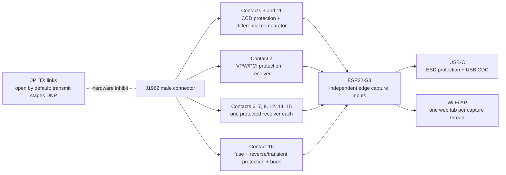

# P0 multi-protocol DLC sniffer: preliminary BOM and channel plan

**Revision status:** architecture and part-selection draft, 2026-11-09. Not released for fabrication or vehicle use. The current `p0_carrier` board is an earlier carrier-only study and does not implement these circuits.

## Scope

P0 is a passive logger for the bus signals exposed at the Prowler's J1962 diagnostic connector. The logger shall maintain independent capture threads for CCD, VPW/PCI, and each SCI conductor that is confirmed populated. The web UI shall expose a tab for each thread, plus a combined timestamped timeline. Firmware must sample independent receiver outputs against one monotonic clock; it must not merge channels into a single UART stream.

The ChryslerScanner V2.1.0 pin table is a useful candidate inventory: pin 2 PCI/VPW; pins 3/11 CCD+/-; pins 6, 7, 9, 12, 14, 15 SCI; pins 4/5 grounds; pin 16 battery. These are **reference-derived candidates**, not verified Prowler wiring facts. The 1999 Prowler service information and physical DLC inspection take precedence. Pins not verified as data remain disconnected from signal circuitry.

## Candidate channel matrix

| Thread | Candidate DLC contacts | Candidate receiver | Current confidence | Notes |
|---|---|---|---|---|
| CCD | 3 (+), 11 (-) | Differential comparator receiver, high impedance, no bus bias/termination | Medium for platform pin mapping; low for exact Prowler population | Dedicated differential front end; independent receiver output. Must preserve common-mode range and polarity. |
| PCI / J1850 VPW | 2 | Automotive-tolerant single-wire receiver, comparator or qualified interface | Medium as ecosystem pin map; unverified for Prowler | Distinct single-wire physical layer. Do not reuse CCD analog front end. |
| SCI-A RX (PCM) | 6 | Protected high-impedance single-wire logic receiver | Medium as ecosystem mapping; unverified | ChryslerScanner identifies this as an RX line. Exact line idle/high voltage and baud behavior need service data/capture. |
| SCI-A TX (PCM/TCM) | 7 | Same receive-only tap class, independent channel | Medium as ecosystem mapping; unverified | Keep it receive-only in P0. |
| SCI-B RX (TCM) | 9 | Same receive-only tap class, independent channel | Medium as ecosystem mapping; unverified | Keep it receive-only in P0. |
| SCI-B RX (PCM) | 12 | Same receive-only tap class, independent channel | Medium as ecosystem mapping; unverified | Keep it receive-only in P0. |
| SCI-A RX (TCM) | 14 | Same receive-only tap class, independent channel | Medium as ecosystem mapping; unverified | Keep it receive-only in P0. |
| SCI-B TX (TCM) | 15 | Same receive-only tap class, independent channel | Medium as ecosystem mapping; unverified | Keep it receive-only in P0. |

“All data available” means every populated data conductor receives its own front end and capture thread. It does not mean the standardized DLC exposes every in-vehicle network, nor that unknown contacts should be probed or driven.

## Signal and power partition

Each receiver output remains a separate MCU input and gets a stable `thread` ID in raw captures. UI tab selection changes only what is displayed; it never filters data out of stored/exported captures. Connector signal grounds, chassis ground, protected supply, and logic ground are distinct nets until their intentional connection points are designed.

## Parts and selection status

| Ref. | Qty. | Proposed part / class | Status |
|---|---:|---|---|
| CN1 | 1 | Macchina CCBDM20 right-angle male J1962 plug, or equivalent with supplied mechanical drawing | Candidate selected for a board-edge plug form factor. Mechanical drawing identifies a 16-pin, 30 V, 5 A connector and dimensions; obtain/measure the actual part before footprint release. The ChryslerScanner V1.44 BOM calls its own footprint `OBD2-90` but does not identify the vendor part. |
| U1 | 1 | ESP32-S3-DevKitC-1 v1.1 for prototype; later ESP32-S3 module | Existing board carrier choice; separate GPIO/timestamp input per receiver. Wi-Fi AP and local web UI. |
| U2 | 1 | USB-C ESD protector, e.g. USBLC6-2SC6 | Reference BOM precedent; verify USB wiring and device-side ESD placement. |
| U3 | 1 | Automotive buck regulator, 12 V DLC to 5 V | Not selected. Must be chosen with input/transient/reverse-polarity protection and a documented current budget. The ChryslerScanner's TD1509P5 is a reference, not adopted. |
| F1, D1, TVS1 | 1 each | Input fuse/current limiter, reverse battery protection, and automotive transient clamp | Required if powered from DLC pin 16; exact network and ratings open pending power budget and transient design. |
| U4 | 1 | TI TLV1701-Q1 single comparator, `TLV1701QDBVRQ1` (SOT-23-5) candidate for CCD differential polarity sensing | Active automotive comparator family; rail-to-rail input and open-collector output. It is not a CCD transceiver. Differential threshold/reference, hysteresis, ESD and bus loading still require a reviewed circuit and bench validation. |
| U5-U6 | 2 | TI TLV1704-Q1 quad comparator, `TLV1704QPWRQ1` (TSSOP-14), candidate for seven independent VPW/SCI receive channels | Active automotive comparator family. Eight channels give one spare; no input channel is shared. This is a receive comparator proposal, not an electrically complete interface. Each candidate line needs its own protected input network and validated threshold. |
| R/C/D input network | per channel | Series impedance, line-specific divider/clamp, reference and hysteresis components | Values intentionally TBD until each voltage range is sourced and circuit bench-tested. A first-order 100 kOhm/47 kOhm divider is only a calculation starting point for lines whose high level supports it; it is not a released value or protection network. No shared analog input across different bus types. |
| RPU1..n | one per logic output | 3.3 V pull-up for open-drain comparator output, where required | Choose after comparator output type and ESP32 input circuit are set; do not pull any ESP32 pin to vehicle voltage. |
| JP_TX_CCD, JP_TX_VPW, JP_TX_SCIx | one per physical layer/line | Physical transmit-inhibit links | Open by default and placed in each driver's enable path; independent hardware disconnection is preferred over a single firmware-controlled gate. A fitted link is not authorization to transmit on a vehicle. |
| U8..n, Qx | DNP / later | Protocol-specific transmit drivers | Do not populate in the P0 vehicle-capture assembly. Need separate reviewed driver topology per physical layer before isolated-bench emulation. The user-suggested CCD complementary MOSFET stage does not apply to SCI/VPW. |
| LED1..3 | 3 | Power, capture, fault/status LEDs | Candidate; current limit and GPIO mapping TBD. |
| TP1..n | 1 set | Battery input, protected rails, logic ground, each bus input, comparator references/outputs | Include at safe, serviceable locations. Label signals and keep them accessible in the enclosure. |
| JUSB1 | 1 | USB-C receptacle or strain-relieved pigtail | Select to match ESP32-S3 USB implementation and enclosure. Include correct CC resistors unless already present on the chosen module. |
| H1 | 1 | 3D-printed enclosure, connector support and strain relief | Fit-check after exact connector and PCB dimensions are verified. |

## ChryslerScanner V1.44 BOM review

The V1.44 BOM contains useful clues: `OBD2-90` J1962 connector footprint, SS34 power diodes, LM2576S-5.0 buck, ESDCAN24-2BLY, AO3400/AO3401 MOSFETs, IRF7317 dual MOSFET, 74HC4066 switches, USBLC6-2SC6, LM393D, status LEDs, and extensive passives. It is a multi-protocol active scanner. We borrow the edge-connector concept and investigate the cited protection/switch/transceiver parts; we do not copy its circuit or assume its values/topology are safe for this design. It is GPL-3.0, so no source artwork/code is copied into this project.

The V2.1.0 schematic describes separate CCD, PCI/VPW, and SCI circuits and makes the candidate pin map above explicit. It also uses switchable active interfaces and diagnostics beyond our initial scope. The precise V2.1 J1962 connector manufacturer/footprint is not identified in the extracted material; the old BOM's `OBD2-90` is only a library footprint name.

## Required implementation before purchase/fab

1. Verify which candidate contacts are populated on the 1999 Prowler and their names/electrical limits in OEM service documents. Pin 4 chassis ground and pin 5 signal ground remain separately identified.
2. Select actual connector and obtain its full pin-layout drawing/STEP; create and inspect its custom footprint against the physical part. The current 88 x 38 mm carrier and generic pigtail header are not the final board.
3. Design separate receiver schematics for CCD differential, VPW/PCI, and each SCI data conductor. Show protection, maximum input voltage, input impedance, switching threshold, hysteresis, polarity, output logic level, and test points.
4. Validate each receiver with an isolated signal generator and current-limited supply; measure loading and output timing. Do not test the transmit stages on a vehicle.
5. Rework firmware to timestamp independent receiver edges and parse each physical protocol in its own thread; add per-thread loss counters, raw capture export, and tabbed web UI.
6. Select protected power and verify startup, cranking envelope, reverse battery, and transient behavior before DLC pin 16 is connected.

The present CAD remains preliminary. Do not order the proposed comparator/MOSFET circuit from the BOM alone. Do not populate or enable transmit hardware for vehicle use.
