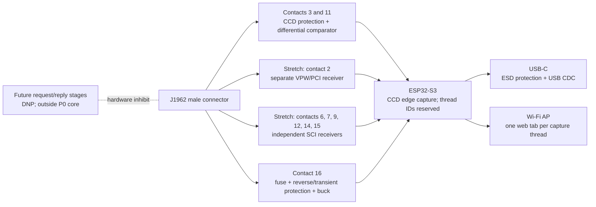

# P0 CCD sniffer: preliminary BOM and stretch-channel plan

**Revision status:** architecture and part-selection draft, 2026-11-09. Not released for fabrication or vehicle use. The current `p0_carrier` board is an earlier carrier-only study and does not implement these circuits.

## Scope

P0 core is a receive-only CCD sniffer on the Prowler's J1962 diagnostic connector. The first board needs the CCD differential front end, ESP32-S3, USB/Wi-Fi interface, and protected power. Other DLC physical layers, J1962 pass-through operation, and active request/reply capture are stretch goals. The capture schema keeps a `thread` field so those can be added later without changing stored records. The first web UI can show the CCD thread; per-thread tabs and a combined timeline become useful when stretch channels exist. No transmit path is populated in the P0 assembly.

The ChryslerScanner V2.1.0 pin table is a useful candidate inventory: pin 2 PCI/VPW; pins 3/11 CCD+/-; pins 6, 7, 9, 12, 14, 15 SCI; pins 4/5 grounds; pin 16 battery. These are **reference-derived candidates**, not verified Prowler wiring facts. Elvira is a 2000 Prowler. Use the archived 1999 factory information as a working carryover reference, then vet critical details against the owner's paper 2000 manual and physical DLC before connection. Pins not verified as data remain disconnected from signal circuitry.

## Candidate channel matrix

| Thread | Candidate DLC contacts | Candidate receiver | Current confidence | Notes |
|---|---|---|---|---|
| CCD | 3 (+), 11 (-) | Differential comparator receiver, high impedance, no bus bias/termination | Core target; verify connector and analog details before vehicle connection | First capture target. Dedicated differential front end and receiver output. |
| PCI / J1850 VPW | 2 | Separate automotive-tolerant single-wire receiver | Stretch; candidate pin mapping only | Distinct physical layer. Do not reuse CCD analog front end. |
| SCI-A RX (PCM) | 6 | Separate protected single-wire receiver | Stretch; unverified on Prowler | Candidate line from ChryslerScanner; voltage and baud need vehicle-specific confirmation. |
| SCI-A TX (PCM/TCM) | 7 | Separate protected receive-only tap | Stretch; unverified on Prowler | Monitor only if confirmed populated. |
| SCI-B RX (TCM) | 9 | Separate protected single-wire receiver | Stretch; unverified on Prowler | Monitor only if confirmed populated. |
| SCI-B RX (PCM) | 12 | Separate protected single-wire receiver | Stretch; unverified on Prowler | Monitor only if confirmed populated. |
| SCI-A RX (TCM) | 14 | Separate protected single-wire receiver | Stretch; unverified on Prowler | Monitor only if confirmed populated. |
| SCI-B TX (TCM) | 15 | Separate protected receive-only tap | Stretch; unverified on Prowler | Monitor only if confirmed populated. |

For the full-DLC stretch goal, “all data available” means every populated data conductor selected for capture gets its own front end and capture thread. It does not mean the standardized DLC exposes every in-vehicle network, nor that unknown contacts should be probed or driven.

## Signal and power partition

Each receiver output remains a separate MCU input and gets a stable `thread` ID in raw captures. UI tab selection changes only what is displayed; it never filters data out of stored/exported captures. Connector signal grounds, chassis ground, protected supply, and logic ground are distinct nets until their intentional connection points are designed.

## Parts and selection status

| Ref. | Qty. | Proposed part / class | Status |
|---|---:|---|---|
| CN1 | 1 | Macchina CCBDM20 right-angle male J1962 plug, or equivalent with supplied mechanical drawing | Candidate selected for a board-edge plug form factor. Mechanical drawing identifies a 16-pin, 30 V, 5 A connector and dimensions; obtain/measure the actual part before footprint release. The ChryslerScanner V1.44 BOM calls its own footprint `OBD2-90` but does not identify the vendor part. |
| U1 | 1 | ESP32-S3-DevKitC-1 v1.1 for prototype; later ESP32-S3 module | Existing board carrier choice; separate GPIO/timestamp input per receiver. Wi-Fi AP and local web UI. |
| U2 | 1 | USB-C ESD protector, e.g. USBLC6-2SC6 | Reference BOM precedent; verify USB wiring and device-side ESD placement. |
| U3 | 1 | Automotive buck regulator, 12 V DLC to 5 V | Not selected. Must be chosen with input/transient/reverse-polarity protection and a documented current budget. The ChryslerScanner's TD1509P5 is a reference, not adopted. |
| F1, D1, TVS1 | 1 each | Input fuse/current limiter, reverse battery protection, and automotive transient clamp | Required if powered from DLC pin 16; exact network and ratings open pending power budget and transient design. |
| U4 | 1 | TI TLV1701-Q1 single comparator, `TLV1701QDBVRQ1` (SOT-23-5) candidate for CCD differential polarity sensing | Active automotive comparator family; rail-to-rail input and open-collector output. It is not a CCD transceiver. Differential threshold/reference, hysteresis, ESD and bus loading still require a reviewed circuit and bench validation. |
| U5-U6 | 0 populated in P0; 2 for stretch | TI TLV1704-Q1 quad comparator, `TLV1704QPWRQ1` (TSSOP-14), candidate for independent VPW/SCI receive channels | Stretch-only candidate. Not required for first CCD capture. Each added physical layer needs its own reviewed input conditioning and verified pin map. |
| R/C/D input network | per channel | Series impedance, line-specific divider/clamp, reference and hysteresis components | Values intentionally TBD until each voltage range is sourced and circuit bench-tested. A first-order 100 kOhm/47 kOhm divider is only a calculation starting point for lines whose high level supports it; it is not a released value or protection network. No shared analog input across different bus types. |
| RPU1..n | one per logic output | 3.3 V pull-up for open-drain comparator output, where required | Choose after comparator output type and ESP32 input circuit are set; do not pull any ESP32 pin to vehicle voltage. |
| JP_TX_CCD, JP_TX_VPW, JP_TX_SCIx | zero populated in P0; later, one per driver | Physical transmit-inhibit links | Request/reply behavior is future work. If isolated-bench drivers are later added, each must have a physical inhibit; any vehicle transmission additionally requires reviewed behavior and explicit user authorization. |
| U8..n, Qx | DNP / later | Protocol-specific transmit drivers | Outside P0 core. The user-suggested CCD complementary MOSFET stage does not apply to SCI/VPW. |
| LED1..3 | 3 | Power, capture, fault/status LEDs | Candidate; current limit and GPIO mapping TBD. |
| TP1..n | 1 set | Battery input, protected rails, logic ground, each bus input, comparator references/outputs | Include at safe, serviceable locations. Label signals and keep them accessible in the enclosure. |
| JUSB1 | 1 | USB-C receptacle or strain-relieved pigtail | Select to match ESP32-S3 USB implementation and enclosure. Include correct CC resistors unless already present on the chosen module. |
| H1 | 1 | 3D-printed enclosure, connector support and strain relief | Fit-check after exact connector and PCB dimensions are verified. |

## ChryslerScanner V1.44 BOM review

The V1.44 BOM contains useful clues: `OBD2-90` J1962 connector footprint, SS34 power diodes, LM2576S-5.0 buck, ESDCAN24-2BLY, AO3400/AO3401 MOSFETs, IRF7317 dual MOSFET, 74HC4066 switches, USBLC6-2SC6, LM393D, status LEDs, and extensive passives. It is a multi-protocol active scanner. We borrow the edge-connector concept and investigate the cited protection/switch/transceiver parts; we do not copy its circuit or assume its values/topology are safe for this design. It is GPL-3.0, so no source artwork/code is copied into this project.

The V2.1.0 schematic describes separate CCD, PCI/VPW, and SCI circuits and makes the candidate pin map above explicit. It also uses switchable active interfaces and diagnostics beyond our initial scope. The precise V2.1 J1962 connector manufacturer/footprint is not identified in the extracted material; the old BOM's `OBD2-90` is only a library footprint name.

## Required implementation before purchase/fab

1. Develop the CCD contact map and electrical limits from the archived 1999 factory manual, recording its page references and the assumed carryover to Elvira (2000). Vet critical details against the paper 2000 manual as needed for design decisions. Pin 4 chassis ground and pin 5 signal ground remain separately identified.
2. Select actual connector and obtain its full pin-layout drawing/STEP; create and inspect its custom footprint against the physical part. The current 88 x 38 mm carrier and generic pigtail header are not the final board.
3. Design and validate the CCD differential receiver first, including protection, input impedance, switching threshold, hysteresis, polarity, logic output and test points.
4. Build the receive-only P0 core and validate it with an isolated signal source and current-limited supply; measure bus loading and timing before vehicle connection.
5. Defer separate VPW/SCI receive channels, pass-through hardware, and request/reply functions to stretch work. When added, keep each physical layer independent and give it a distinct capture thread and UI tab.
6. Select protected power and verify startup, cranking envelope, reverse battery, and transient behavior before DLC pin 16 is connected.

The present CAD remains preliminary. Do not order the proposed comparator/MOSFET circuit from the BOM alone. Do not populate or enable transmit hardware for vehicle use.
